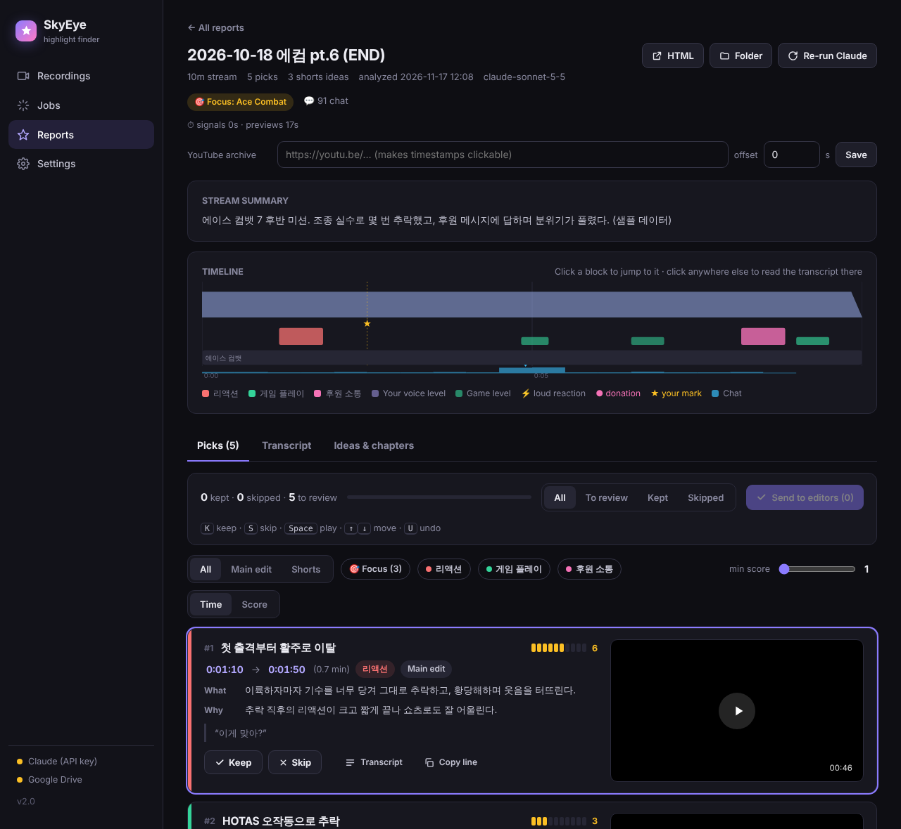

# SkyEye 👁️

방송 녹화본에서 **편집할 만한 장면**을 찾아서, 편집자에게 넘길 목록을 만들어 주는 Windows 프로그램입니다.

> 스크린샷은 가짜 샘플 데이터입니다. 실제 방송 내용이 아닙니다.

**장면은 스트리머가 직접 고릅니다. 편집자는 편집만 합니다.** SkyEye는 후보를 보여 주고, 사용자가 **Keep / Skip**을 누르고, Keep한 장면만 Discord로 편집자에게 보냅니다.

## 어떻게 동작하나요

1. **녹화 가져오기**: Google Drive 폴더(또는 이 PC)에서 녹화를 받습니다. 원본은 읽기만 하고 절대 바꾸지 않습니다.
2. **받아쓰기**: 마이크·디스코드·후원 같은 오디오 트랙을 따로 GPU(Whisper)로 받아 적습니다.
3. **신호 찾기**: 큰 리액션, 후원, 방송 중 ⭐로 찍어 둔 순간, (있으면) 채팅 폭주를 표시합니다.
4. **Claude가 고르기**: 빠른 모델이 후보를 넓게 훑고, 메인 모델이 앞뒤 맥락을 읽어 진짜 장면만 시작·끝 시간과 함께 남깁니다.
5. **리뷰**: 각 장면의 미리보기 클립을 보고 **K**(Keep) / **S**(Skip)로 빠르게 고릅니다.
6. **편집자에게 전송**: **Send to editors**를 누르면 Keep한 장면만 담은 웹페이지 링크가 Discord 카드로 올라갑니다.

> 분석이 끝나도 **자동으로 올라가는 건 없습니다.** 전송 버튼을 눌러야만 Discord에 올라갑니다.

## 시작하기

**`SkyEye.bat`을 더블클릭**하세요. 처음엔 설치(몇 분)와 바탕화면 **SkyEye** 바로가기 만들기까지 자동으로 합니다. 이후엔 바로가기로 실행합니다.

Python이 없다고 나오면 `winget install Python.Python.3.12` 후 다시 실행하세요.

### 첫 설정 (앱 안의 Settings)

1. **Claude**: 내 구독으로 쓰려면 *Install Claude Code*를 누르고 안내대로 로그인합니다(추가 비용 없음, 구독 사용량에서 차감). API 키로 쓰는 방법도 있습니다.
2. **Google Drive**: *Connect Google Drive*.
3. **오디오 트랙**: Recordings에서 녹화 하나의 **Tracks**를 눌러 각 트랙이 무엇인지(마이크, 게임, 디스코드…) 지정합니다.
4. **채널 소개**: 캐릭터, 밈, 별명, 편집자가 좋아하는 스타일을 적습니다. 결과 품질에 가장 큰 영향을 줍니다.
5. **내 YouTube 채널 학습**: 채널 링크를 넣고 *Learn from my channel*을 누르면, 올린 영상의 제목·조회수 등을 읽고 **스타일 프로필**을 만들어 분석에 반영합니다.
6. **Discord**: 채널 설정 → 연동 → 웹후크에서 URL을 복사해 붙여넣습니다.

## 매일 쓰는 법

| 메뉴 | 하는 일 |
|---|---|
| **Recordings** | 녹화 목록(New / Transcribed / Analyzed). 체크하고 **Analyze selected** |
| **Jobs** | 진행 상황(다운로드 → 오디오 → 받아쓰기 → Claude → 리포트). 취소·대기열 가능 |
| **Reports** | 타임라인, 장면 목록, 대본, **Re-run Claude**(받아쓰기 없이 다시 분석) |
| **Settings** | 위의 모든 설정 |

**리뷰 단축키**: `K` Keep · `S` Skip · `Space` 재생 · `↑/↓` 이동 · `U` 되돌리기. Keep/Skip 기록은 다음 분석에서 내 취향 예시로 쓰입니다.

### 🎯 Focus: 이번 방송에서 꼭 찾을 것 지정

Analyze나 Re-run을 누르면 작은 창이 떠서 "이번엔 뭘 찾을지"를 물어봅니다.

- **Auto**(기본): 파일 이름에 키워드가 있는 첫 프리셋을 고릅니다. 예: `에컴` → *Ace Combat*
- **None**: 평소처럼. **프리셋 선택** 또는 **Extra instructions**(추가 지시)도 가능합니다.
- Focus에 걸린 장면은 웃기지 않아도 **전부** 찾아 🎯로 표시합니다(리포트·편집자 페이지 모두).
- 프리셋은 Settings → Focus presets에서 추가·수정합니다(기본: Ace Combat, Trickal).

### 💬 Allmind 채팅 (선택)

Allmind가 올리는 `….markers.json`(버전 2)에 채팅이 들어 있으면, SkyEye가 후원 메시지·"ㅋㅋㅋ" 폭주 같은 반응을 참고하고 리포트에도 보여 줍니다. 시청자 반응은 몇 초 늦으니 **Chat delay**(기본 6초)만큼 앞당겨 읽습니다. 채팅 파일이 없으면 평소와 똑같이 동작합니다. 형식은 `STREAM_DESK_MARKERS.md`, `docs/ALLMIND_CHAT_LOG.md` 참고.

### 🌐 편집자 페이지 (Cloudflare R2, 선택)

Settings → Editor page를 설정하면 Keep한 장면과 작은 클립(360p)을 R2에 올리고 **링크 하나**만 Discord에 올립니다. 스트림마다 길고 추측 불가능한 주소를 쓰니 링크를 아는 사람만 열 수 있습니다. 설정 안 하면 Discord 카드 아래에 장면별 클립이 올라갑니다.

Cloudflare에서 해 둘 것: R2 켜기 → 버킷 만들기 → 공개 접근(r2.dev) 허용 → 일정 기간 뒤 삭제 규칙(90~180일) → *Object Read & Write* API 토큰 발급. 그 값을 Settings에 넣고 *Test connection*을 누릅니다.

## 안전 · 개인정보

- **Google Drive의 녹화는 삭제·이동·수정하지 않습니다.** 읽기 전용이며, 처리용 임시 복사본만 이 PC에서 지웁니다.
- 앱은 **Quit SkyEye**(Settings → App)를 누를 때까지 백그라운드에서 계속 실행되고, 작업 중에는 PC가 잠들지 않습니다.
- **공개하면 안 되는 파일**: `api_key.txt`, `rclone.conf`, `discord_webhook.txt`, `r2_keys.json`, `config.yaml`. 이 저장소는 `.gitignore`로 제외하고 있으니 `git add -f`로 올리지 마세요.

## 문제 해결

- **앱이 안 열려요** → 폴더의 `app.log`를 확인하세요.
- **"GPU load failed … falling back to CPU"** → NVIDIA 드라이버를 업데이트하고 `setup.bat`을 다시 실행하세요.
- **Drive 로그인/토큰 오류** → Settings → Google Drive → *Log in again*.
- **업데이트 후 화면이 그대로예요** → SkyEye 창에서 `Ctrl+R`, 그래도 같으면 Settings → Quit 후 다시 실행하세요.

## 개발자용

`app.py`(GUI 서버) · `scout.py`(엔진) · `twopass.py`(2단계 분석) · `editor_page.py` / `publish.py`(편집자 페이지) · `discord_post.py` · `learn.py` · `ui/index.html`(화면). 자세한 규칙은 `CLAUDE.md`, 다른 프로그램과의 규격은 `docs/`와 `STREAM_DESK_MARKERS.md`에 있습니다.
